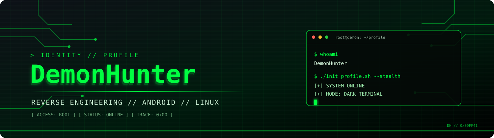
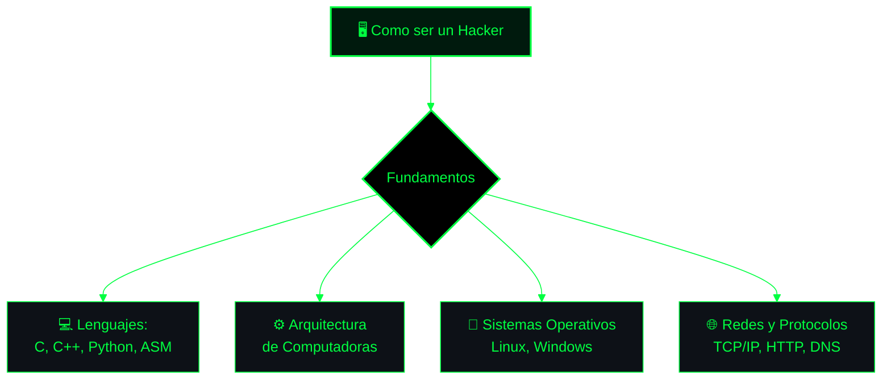

<!--
  DEMONHUNTER // PROFILE README
  DARK TERMINAL EDITION
  Palette: #0d1117 / #00ff41 / #001a0d
-->

<div align="center">



<br/>

</div>

 

<div id="header" align="center">
  
</div> 

 

## `> CONNECT // SOCIAL NETWORKS`

<div align="center">

<a href="Aaaa" target="_blank">
  
</a>
<a href="https://youtube.com/@hackcub2090" target="_blank">
  
</a>
<a href="Aaaa" target="_blank">
  
</a>
<a href="https://t.me/demonr_rip" target="_blank">
  
</a>

</div>


<div align="center">
 
</div>

## `> ROADMAP // HACKER FOUNDATIONS`



## `> SYSTEM STATUS`

```diff
+ [ SYSTEM STATUS ]
+ [ ROOT ACCESS GRANTED ]
@@ 0x00000000 :: trace erased :: connection encrypted :: 0x00ff41 @@
```

## `> ACTIVITY // GITHUB ANALYTICS`

<div align="center">


<br/>


</div>

 

<div align="center">

```bash
┌──[root@demon]─[~]
└──╼ $ sudo shutdown -h now

  [✓] Saliendo del sistema...
  [✓] Conexión cerrada.
  [✓] Hasta la próxima, operador.
```

**`0x00FF41 // END OF TRANSMISSION`**

</div>
