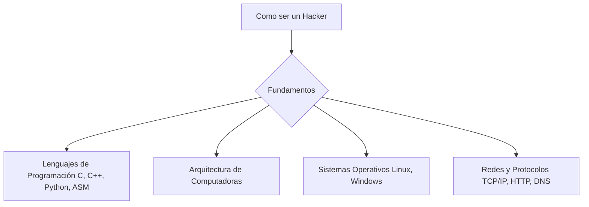

<p align='center'>
    
</p>

<div id="header" align="center">
  
</div>

<div align="center">

```bash
┌──[root@demon]─[~]
└──╼ $ ./init_profile.sh --dark --stealth --no-logs
[+] Anonymous node connected...
[+] Firewall bypassed ✓
[+] Identity: DemonHunter
[!] Access level: ROOT
```

</div>


<div align="center">
  <a href="Aaaa" target="_blank">
    
  </a>
  <a href="https://youtube.com/@hackcub2090?si=pyQchgOtOjoQM-I5" target="_blank">
    
  </a>
  <a href="Aaaa" target="_blank">
    
  </a>
  <a href="https://t.me/demonr_rip" target="_blank">
    
  </a> 
  <a href="aa" target="_blank">
    
  </a>
</div>


<div align="center">

```bash
# ╔═══════════════════════════════════════════════════════════════╗
# ║  > Herramientas y materiales tecnológicos                     ║
# ║  > Cargando módulos del sistema...                            ║
# ╚═══════════════════════════════════════════════════════════════╝
```

</div>

<!-- Herramientas y materiales texnologicos -->


<div align="center">

```diff
- [ SYSTEM STATUS ]
+ [ ROOT ACCESS GRANTED ]
@@ 0x00000000 :: trace erased :: connection encrypted :: 0x00ff41 @@
```

</div>

<!--Historia de GitHub-->
<div align="center">

[](https://git.io/streak-stats)

<div/>

<div  id="header" align="center">
  
</div>

<div align="center">

```bash
┌──[root@demon]─[~]
└──╼ $ sudo shutdown -h now
[✓] Saliendo del sistema... conexión cerrada.
```

</div>
